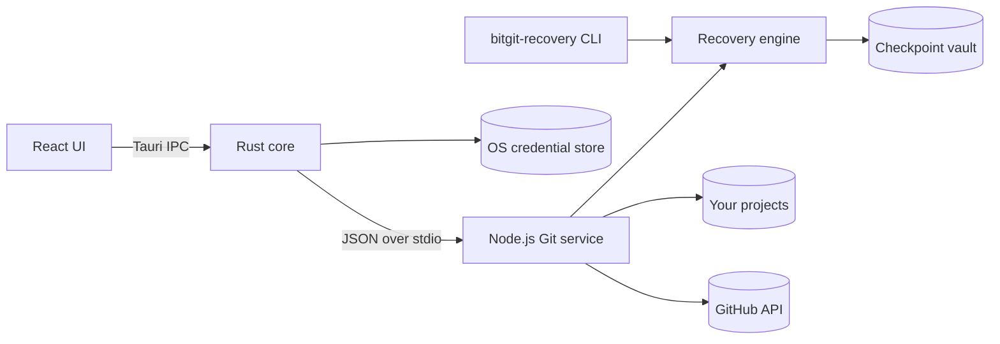

<div align="center">


# BitGit

**Save the version that worked. See what changed. Get it back.**

A desktop app for recovering code during AI-assisted development,<br>
with a visual Git dashboard for the projects you publish.

[](https://github.com/sevenevesai/bitgit/releases/latest)
[](https://github.com/sevenevesai/bitgit/actions/workflows/ci.yml)
[](#install)
[](LICENSE)

[**Download**](https://github.com/sevenevesai/bitgit/releases/latest) ·
[Website](https://seveneves.ai/bitgit/) ·
[Documentation](#documentation) ·
[For AI agents](#for-ai-agents) ·
[Report a bug](https://github.com/sevenevesai/bitgit/issues/new)

</div>

---

An AI coding agent can change dozens of files in a few minutes. When a feature that worked an hour
ago breaks, the working version is often gone: it was never committed, it sits among commits nobody
tested, or Git's staging rules make it hard to say what a restore would bring back.

BitGit keeps named, byte-exact copies of a project folder on your computer and shows exactly which
files each copy covers. Compare any saved version with your current files, recover it into a new
folder, or repair only the files you choose. Your project's branch, index and remotes stay
untouched while you do. GitHub is optional, and so is Git: a plain folder works.

## Features

### Save & Recover

- **Named milestones.** Save a version before a risky change, with an optional note. Preview every
  file it will include, and see why others are left out (dependencies, build output, likely
  secrets).
- **Automatic saves.** Opt in per project to save after your files stay unchanged for 1–60
  minutes while BitGit is open. Every version is kept; nothing is pruned.
- **Compare.** See which files restoring a version would add, replace or delete, with a text diff
  for each.
- **Recover a copy.** Write any version into a new folder, verified file by file against the saved
  copy. Your working project is not touched.
- **Repair selected files.** Restore only the files you tick. BitGit saves a safety checkpoint
  first, and if a repair stops part-way it offers an explicit undo.
- **Remote backup.** Upload a version to a GitHub repository or a local bare repository, read it
  back to confirm it, and restore it on another computer with no local history.

### Find what broke

- **Notes and screenshots** attached to one exact version: what you tested and whether it passed.
- **Explicit checks.** Run a command such as `npm test` against a recovered copy of a version,
  never in your project folder.
- **Regression search.** Mark a known-good and a known-bad version, then answer Good, Bad or Skip
  for each version BitGit suggests until it finds the first bad one.

### Visual Git

- **Multi-project dashboard** with branch, upstream, ahead/behind counts and the time of the last
  successful check for every repository, refreshed in the background every 5 minutes.
- **Publish only what you choose.** Pick whole files to commit and push. Nothing is preselected
  and nothing is staged for you.
- **Checks before anything is sent.** Likely credentials, `.env` files and files over 100 MB are
  blocked; warnings need an explicit confirmation.
- **Branches, commits, stashes and tags** in a details view. Merges of the branches you select use
  `--no-ff` and keep the source branches. BitGit never force-pushes.
- **GitHub integration** to create, clone and link repositories.
- **Bulk import** by scanning a folder for existing repositories.
- **Analytics** with commit history, an activity heatmap and repository health.
- **Open in your editor:** VS Code, Cursor, Sublime Text or a custom command.

### For scripts and agents

- **JSON harness CLI** on the same engine and history as the app: one JSON request in, one JSON
  line out. An agent can save a milestone before it edits and check its work afterwards. See
  [For AI agents](#for-ai-agents).

## Install

Download the installer for your platform from the
[latest release](https://github.com/sevenevesai/bitgit/releases/latest).

| Platform | File | First launch |
|---|---|---|
| Windows 10/11 (x64) | `BitGit_<version>_x64-setup.exe` or `BitGit_<version>_x64_en-US.msi` | The installers are not code-signed. If SmartScreen appears, choose **More info → Run anyway**. |
| macOS 11+ (Apple Silicon) | `BitGit_<version>_aarch64.dmg` | Not notarized by Apple yet. Open BitGit once, then choose **Open Anyway** in System Settings → Privacy & Security. |
| macOS 11+ (Intel) | `BitGit_<version>_x64.dmg` | As above. |
| Linux (x86_64) | `bit-git_<version>_amd64.AppImage` | `chmod +x` the file and run it. Needs FUSE 2 (`libfuse2`). |

**Every platform also needs** [Git](https://git-scm.com/downloads) and
[Node.js](https://nodejs.org/) 20 or later (22 or 24 recommended). BitGit runs its Git service on
your Node.js. On macOS and Linux it reads your login shell's `PATH`, so it finds the same `node`
and `git` as your terminal even when started from Finder, the Dock or a desktop menu.

BitGit checks for a newer release at startup and offers to install it. macOS support is in beta.
On Linux, storing a GitHub token needs a running Secret Service such as GNOME Keyring, KWallet or
KeePassXC. Per-platform steps, troubleshooting, data locations and uninstalling are in
[INSTALL.md](INSTALL.md).

## Quick start

1. Click **Add Project** and link a project folder. It does not need to be a Git repository.
2. On the project card, open **Save & Recover**, review the files it will include, name the version
   (for example, "Checkout works") and save it.
3. Keep working. Turn on **Automatic saves** in the same window if you want versions saved
   whenever your files settle.
4. When something breaks, select a version under **History** and choose **Compare & repair** or
   **Recover copy**.
5. Optional: add a GitHub token in **Settings** to create, clone and publish repositories. It needs
   the `repo` scope (or `public_repo` for public repositories only) and `read:user`.

> [!IMPORTANT]
> A saved version is a copy of your source files. It does not include databases, credentials,
> installed dependencies, external services or deployment state, and nothing tests that the code
> runs. Versions are stored on this computer; use **Remote backup** to protect against disk loss.

The [Save & Recover guide](docs/RECOVERY_GUIDE.md) walks through each tab and what every status
means.

## For AI agents

### Protect a project from an agent or script

`bitgit-recovery` is a command-line front end to the recovery engine. Versions it saves appear in
the app, and the reverse. Build it from a source checkout:

```bash
git clone https://github.com/sevenevesai/bitgit.git
cd bitgit
npm --prefix git-service ci
npm --prefix git-service run build
```

Each call reads one JSON request on stdin and writes one JSON line to stdout:

```bash
# Save a milestone before the agent starts editing
echo '{"action":"create","label":"Before auth refactor","note":"login works by hand"}' \
  | node git-service/dist/recovery-cli.js --repo /work/app

# List saved versions and settings
echo '{"action":"state"}' | node git-service/dist/recovery-cli.js --repo /work/app

# Run the tests against a recovered copy of a saved version
echo '{"action":"runCheck","checkpointId":"<id>","command":"npm test","timeoutSeconds":300}' \
  | node git-service/dist/recovery-cli.js --repo /work/app
```

- **Output:** `{"success":true,"data":...}` or `{"success":false,"error":"..."}`. Exit code 0 means
  success, 1 a failed request, 2 bad arguments or malformed input.
- **Actions:** `state`, `preview`, `create`, `compare`, `recover`, `repair`, `repairRollback`,
  `backup`, `verifyBackup`, `remoteList`, `remoteImport`, `settings`, `autoTick`, `evidence`,
  `evidenceImage`, `runCheck`, `regressionStart`, `regressionObserve`, `regressionGet`.
- **Boundaries:** nothing runs unless a request is sent: no daemon, no progress output, no
  credential flags. Remote actions use your Git credential helper. `runCheck` is not a sandbox: the
  command runs with your normal user permissions, in a fresh recovered copy.

The full protocol, including a step-by-step regression loop, is in
[Automation and CLI](docs/RECOVERY_AUTOMATION.md#cli). `--help` prints a summary.

### Work on BitGit with a coding agent

[CLAUDE.md](CLAUDE.md) is the agent brief for this repository: build and test commands, the
invariants every change must keep, and a map of the design contracts. It is plain Markdown that
any coding agent can read.

## How it works



- **React UI** (TypeScript, Zustand, Tailwind CSS) renders the dashboard and the recovery
  workspace.
- **Rust core** (Tauri 1) validates every command, keeps the project list, stores the GitHub token
  in the OS credential store and supervises the Git service.
- **Node.js Git service** (simple-git, Octokit) runs Git and GitHub operations and the recovery
  engine.
- **Checkpoint vault:** each project's saved versions live in a separate bare Git repository under
  BitGit's data folder. Saving reads your files without changing the project's HEAD, index,
  branches or remotes, and history stays available even if the project folder is deleted.

Design details: [recovery design](docs/RECOVERY_DESIGN.md),
[Git operations](docs/GIT_OPERATIONS.md) and [native integration](docs/NATIVE_RECOVERY.md).

## Safety guarantees

- Reading status and saving versions never change your project's HEAD, index, branches or remotes.
- Publishing commits only the files you selected, or pushes commits that already exist. There is no
  implicit stage-all.
- BitGit never force-pushes. Explicit branch merges use `--no-ff` and keep the source branches.
- Credential and oversize problems block publishing; only warnings can be overridden.
- Recovery writes to a new folder by default. Repairs take a safety checkpoint first and never
  silently rewrite current work.
- GitHub tokens live in Windows Credential Manager, the macOS Keychain or the Linux Secret Service,
  never in files.
- Commands run only when you ask, with your normal user permissions, in a recovered copy. Saving,
  listing and restoring never install dependencies or run project scripts.
- No telemetry. BitGit connects only to GitHub and the Git remotes you use, plus the update check
  against this repository's releases.

## Known limitations

- Automatic saves run only while BitGit is open.
- Publishing works on whole files; there is no line or hunk selection.
- A branch that is both behind and dirty, or diverged, cannot be resolved inside BitGit yet.
- Secret screening is heuristic, not a guarantee.
- Linux ships only as an AppImage: the `.deb` and `.rpm` need webkit2gtk 4.0, which current
  distributions no longer ship. They return with the move to Tauri 2.
- Keyboard shortcuts use Ctrl on every platform, including macOS.

## Documentation

| Guide | Covers |
|---|---|
| [Install](INSTALL.md) | Per-platform setup, troubleshooting, data location, uninstalling |
| [Save & Recover guide](docs/RECOVERY_GUIDE.md) | The recovery workspace, what each status means, limits |
| [Recovery workflows](docs/RECOVERY_WORKFLOWS.md) | Automatic saves, notes and checks, regression search, interrupted repair |
| [Visual Git guide](docs/VISUAL_GIT_GUIDE.md) | Publishing, status, bulk actions and branches |
| [Automation and CLI](docs/RECOVERY_AUTOMATION.md) | Harness protocol, check isolation, regression search |

For contributors:

| Reference | Covers |
|---|---|
| [Build](BUILD.md) | Installers, signing and release builds for each platform |
| [Recovery development](docs/RECOVERY_DEVELOPMENT.md) | Development conventions and verification |
| [Recovery design](docs/RECOVERY_DESIGN.md) | Vault, coverage, repair, remote trust and verification |
| [Git operations](docs/GIT_OPERATIONS.md) | Selection, validation, status, diffs and branch semantics |
| [Native integration](docs/NATIVE_RECOVERY.md) | Command validation, cache, credentials and test isolation |
| [Verification](docs/RECOVERY_VERIFICATION.md) | Test evidence and verification boundaries |

## Build from source

Prerequisites: Git, Node.js 20 or later, Rust 1.89 or later, and the
[Tauri 1 system dependencies](https://v1.tauri.app/v1/guides/getting-started/prerequisites) for
your platform. On Linux, build on Ubuntu 22.04 or Debian 12, which still ship webkit2gtk 4.0.

```bash
npm ci
npm --prefix git-service ci
npm --prefix git-service run build   # required before the first launch
npm run tauri:dev                    # run the app in development mode
npm run tauri:build                  # installers in src-tauri/target/release/bundle/
```

Tests and checks, all of which CI runs on Windows, macOS and Linux:

```bash
npm run build                                     # type check and frontend build
node --test git-service/tests/*.test.mjs          # service tests in disposable repositories
cargo test --manifest-path src-tauri/Cargo.toml   # needs the frontend build first
```

In Windows PowerShell, run the service tests with
`node --test (Get-ChildItem git-service/tests -Filter *.test.mjs).FullName`.

### Project structure

```text
bitgit/
├── src/            React UI: dashboard, recovery workspace, Zustand store
├── src-tauri/      Rust core: Tauri commands, credentials, project cache, service supervisor
├── git-service/    Node.js Git service, recovery engine and bitgit-recovery CLI
│   └── tests/      node:test suites against disposable repositories
├── docs/           User guides, design contracts and plans
├── scripts/        Build, signing and bundle smoke-test scripts
└── website/        Project website
```

## Roadmap

Open work is tracked in the [recovery plan](docs/RECOVERY_PLAN.md) and the
[macOS and Linux build plan](docs/plans/macos-linux-build.md); that plan covers the move to
Tauri 2, which brings back `.deb` and `.rpm` packages. Proposed features, including faster history,
guided onboarding, a protection overview and background capture, are written up as
[design specs](docs/design/recovery-evolution/README.md). They are proposals, not commitments.

## Contributing

Bug reports, feature requests and pull requests are welcome. Read [CONTRIBUTING.md](CONTRIBUTING.md)
first, run the build and tests above before opening a pull request, and keep the
[invariants](CLAUDE.md#invariants) intact.

## Security

Please report vulnerabilities privately, not in a public issue. [SECURITY.md](SECURITY.md) explains
how, and how BitGit stores credentials and local data.

## License

[MIT](LICENSE)

## Acknowledgments

BitGit is built on [Tauri](https://tauri.app/), [React](https://react.dev/),
[simple-git](https://github.com/steveukx/git-js), [Octokit](https://github.com/octokit/rest.js),
[Tailwind CSS](https://tailwindcss.com/), [Zustand](https://github.com/pmndrs/zustand) and
[Lucide](https://lucide.dev/).
